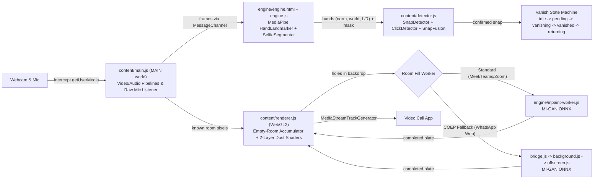

<div align="center">
  
  <h1>Snap Vanish</h1>
  <p><strong>Snap your fingers on a video call, dissolve into dust, leave an empty room behind, and silently mute your mic — snap again to reappear.</strong></p>
  <p>
    
    
    = 116" />
    
  </p>
</div>

---

## Overview

**Snap Vanish** is a Chrome Manifest V3 extension (`v1.1.0`) that sits locally between your webcam/microphone and browser video calls. When it detects a real finger snap (combining **computer-vision hand tracking** + **acoustic snap-click confirmation**, or manual trigger via button / `Alt+Shift+V`), it:

1. **Silently mutes your outgoing call microphone** (sending silence while leaving the call app's own mute button untouched).
2. **Dissolves you into directional WebGL2 dust particles**, revealing an empty room plate built from your real room + local AI inpainting.
3. **Brings the dust back together onto your live video** and restores your mic state on your second snap.

---

## Supported Platforms

| Platform | URL Pattern(s) | Notes |
| --- | --- | --- |
| **Google Meet** | `https://meet.google.com/*` | Works directly in Chrome |
| **Microsoft Teams (Web)** | `https://teams.microsoft.com/*`, `https://teams.live.com/*`, `https://teams.cloud.microsoft/*` | Web version in Chrome |
| **Zoom (Web Client)** | `https://*.zoom.us/*`, `https://*.zoom.com/*` | Choose *"Join from your browser"* |
| **WhatsApp Web** | `https://web.whatsapp.com/*` | Runs AI room fill via MV3 Offscreen relay to bypass COEP restrictions |
| **Practice Room** | Built-in extension page (`practice/practice.html`) | Safe offline test stage with live mic meter & optional skeleton overlay |

> **Tip:** Turn **OFF** the meeting app's own background blur or virtual background so Snap Vanish can accurately learn your empty room.

---

## Why Snap Vanish Is Safe & Private

Privacy and predictable failure handling are built into the extension architecture:

- **100% Local On-Device Execution:** Every AI model (**MediaPipe HandLandmarker**, **MediaPipe SelfieSegmenter**, and **MI-GAN v2** ONNX inpainting) and WASM runtime is bundled offline inside [`models/`](models) and [`vendor/`](vendor). Zero video, audio, or room frames are uploaded or saved to disk.
- **Strict Content Security Policy (No Outbound Network Calls):** [`manifest.json`](manifest.json) enforces:
  ```json
  "extension_pages": "script-src 'self' 'wasm-unsafe-eval'; object-src 'self'; worker-src 'self'; connect-src 'self'; img-src 'self' data:;"
  ```
  `connect-src 'self'` blocks extension engine frames and workers from making external HTTP/WebSocket requests.
- **Minimal Permissions:** Only requests `"storage"` (saving popup settings locally) and `"offscreen"` (for the COEP-isolated room-fill worker fallback on WhatsApp Web). No `<all_urls>`, tabs, browsing history, cookies, or analytics permissions.
- **Fail-Closed Video Protection While Vanished:** Inside [`content/main.js`](content/main.js), while you are in `vanishing`, `vanished`, or `returning`, any frame processing error withholds raw webcam frames instead of flashing you back on camera accidentally.
- **Respects Your Existing Meeting Mute:** [`content/main.js`](content/main.js) wraps `MediaStreamTrack.enabled` rather than overriding the meeting UI. If you already muted yourself inside Meet/Teams/Zoom/WhatsApp before snapping, snapping back keeps your call mute active.
- **Debug Overlay Never Broadcasts:** **Hand tracking debug** draws the 21-point hand skeleton strictly on Practice Room's local `<canvas id="overlay">` and popup readout — never on your outgoing call video stream.
- **Safe Extension Reload Handling:** [`content/bridge.js`](content/bridge.js) detects extension reloads/updates (`chrome.runtime.id` invalidation), tears down stale listeners/frames cleanly, restores your camera/mic if vanished, and avoids spamming `chrome://extensions` with unhandled errors.

---

## How It Works (Architecture)



### Key Pipeline Stages

1. **Stream Interception ([`content/main.js`](content/main.js)):**
   - Wraps `navigator.mediaDevices.getUserMedia()` with `MediaStreamTrackProcessor` and `MediaStreamTrackGenerator`.
   - Keeps an independent unprocessed microphone track (`echoCancellation: false`, `noiseSuppression: false`, `autoGainControl: false`, falling back cleanly if unavailable) strictly for detecting crisp high-frequency snap clicks without altering your outgoing voice settings.
   - Dynamically adapts analysis resolution (`896px` when GPU/FPS allows, `640px` balanced default, `512px` low-FPS fallback) using `resizeQuality: 'medium'`.
   - Once the empty room is learned (`renderer.hasFill`), reduces background segmentation to every 10th frame (~450 ms max cap) while visible and an ~850 ms heartbeat while vanished so hand tracking stays fast.

2. **Two-Stage Sensor Fusion ([`content/detector.js`](content/detector.js)):**
   - **Vision (`SnapDetector`):** Tracks up to 2 hands in MediaPipe `VIDEO` mode (`minHandDetectionConfidence: 0.4`, `minHandPresenceConfidence: 0.35`, `minTrackingConfidence: 0.35`) with `Left`/`Right` handedness ID so crossing hands keep separate state. Dampens predicted depth jitter (`0.35` weight on `dz`), requires thumb-tip (`4`) to middle-tip (`12`) pinch -> clear separation -> middle finger slap toward palm, and rejects whole-hand waving (`moved >= 1.5`). Also produces velocity-adaptive smoothed overlay landmarks (`detector.smoothed`).
   - **Audio (`ClickDetector`):** Uses a `1500 Hz` biquad high-pass filter with an adaptive noise floor, pre-snap friction exclusion (`5 ms`), burst width + fast decay tail verification (rejecting speech/sustained noise), and `NaN`/`Infinity` resilience.
   - **Fusion (`SnapFusion`):** Correlates a visual snap motion with an acoustic click across `[armedAt - 200 ms, releasedAt + 450 ms]` to support wireless/Bluetooth mic latency.

3. **Room Learning & AI Inpainting ([`content/renderer.js`](content/renderer.js), [`engine/inpaint-worker.js`](engine/inpaint-worker.js)):**
   - WebGL2 continuously accumulates static room pixels outside your person silhouette mask and hand bounding boxes (`uHands`).
   - For pixels occluded behind your body, **MI-GAN v2** (`migan_pipeline_v2.onnx` via **ONNX Runtime Web** WASM, seeded with multi-scale pull-push smoothing) synthesizes natural background textures inside a Web Worker — or seamlessly via [`engine/offscreen.html`](engine/offscreen.html) + [`background.js`](background.js) on sites like WhatsApp Web that enforce strict `Cross-Origin-Embedder-Policy`.

4. **WebGL2 Dust Particle Transition ([`content/renderer.js`](content/renderer.js)):**
   - Captures your exact body silhouette (`dustFrame` / `dustMask`) and renders two layered particle grids flying out in your chosen wind direction while cross-fading to the empty room plate (with subtle animated sensor grain so the feed looks alive rather than frozen).

---

## Installation (Unpacked Extension)

1. Download or clone this repository and keep the `snap-vanish` folder (containing [`manifest.json`](manifest.json)) in a permanent location.
2. Open Chrome (`>= 116`) or Edge and go to `chrome://extensions`.
3. Enable **Developer mode** (top-right toggle).
4. Click **Load unpacked** and select the `snap-vanish` folder.
5. Click the puzzle-piece Extensions icon in Chrome's toolbar and **pin Snap Vanish**.
6. Refresh any already-open call tab so the extension attaches cleanly.

---

## Using Practice Room & Controls

Click the **Snap Vanish** extension icon -> **Open practice room** -> **Start camera** (grant camera & mic permissions):

| Control / Feature | Description | Default |
| --- | --- | --- |
| **Extension Switch** | Instantly enables/disables Snap Vanish (turning off immediately restores & unmutes) | `ON` |
| **Snap now / Shortcut** | Manual vanish/return toggle; default shortcut `Alt+Shift+V` (`Option+Shift+V` on Mac, customizable at `chrome://extensions/shortcuts`) | `Alt+Shift+V` |
| **Snap sensitivity** | Range `1` (**Strict**) to `10` (**Forgiving**) tuning pinch/release thresholds & audio click threshold | `5` |
| **Dust duration** | Animation duration (`1 s` to `6 s`, step `0.5 s`) for vanishing and returning | `2.5 s` |
| **Dust direction** | Particle travel direction (`↗ Up and right`, `→ Right`, `← Left`, `↖ Up and left`, `↑ Up`, `↓ Down`) | `up-right` |
| **Hand tracking debug** | Shows local 21-point hand skeleton (`L`/`R` wrist badge + thumb–middle pinch guide), tracking FPS, motion notes, and click diagnostics inside Practice Room/Popup | `OFF` |
| **Capture empty room** | 5-second countdown to step out of frame so your real room is captured without AI guessing | Manual |
| **Re-learn room** | Clears the accumulated room plate (useful if you move your camera or lighting changes) | Manual |

---

## Project Structure

```text
snap-vanish/
├── manifest.json                 # MV3 manifest, strict CSP, supported origins, permissions
├── background.js                 # Alt+Shift+V shortcut handler & MV3 offscreen relay
├── content/
│   ├── detector.js               # SnapDetector, ClickDetector, SnapFusion & landmark smoothing
│   ├── renderer.js               # WebGL2 shaders, room plate accumulator & 2-layer dust renderer
│   ├── main.js                   # getUserMedia hooks, audio mute guard, smart frame/FPS scheduling
│   └── bridge.js                 # Isolated <-> MAIN relay, offscreen messaging, reload teardown
├── engine/
│   ├── engine.html / engine.js   # Sandboxed MediaPipe HandLandmarker + SelfieSegmenter (GPU/CPU)
│   ├── inpaint-worker.js         # Coalesced MI-GAN ONNX inpainting Web Worker
│   └── offscreen.html / .js      # MV3 Offscreen Document fallback for COEP-strict sites
├── popup/                        # Toolbar popup controls, status diagnostics & settings sync
├── practice/                     # Offline Practice Room page, audio meter & local skeleton canvas
├── models/                       # Local offline AI model binaries (.task, .tflite, .onnx)
├── vendor/                       # Bundled MediaPipe Tasks Vision & ONNX Runtime Web assets
├── icons/                        # Extension icons (16x16, 48x48, 128x128)
└── licenses/                     # Third-party license attributions & SHA-256 checksums
```

---

## Tech Stack & Bundled Models

See [`licenses/THIRD_PARTY.txt`](licenses/THIRD_PARTY.txt) and [`licenses/Apache-2.0.txt`](licenses/Apache-2.0.txt) for full third-party attribution and SHA-256 verification hashes:

| Component | Purpose | License |
| --- | --- | --- |
| **MediaPipe Tasks Vision (`0.10.14`)** | WASM/WebGL vision runtime ([`vendor/mediapipe/`](vendor/mediapipe)) | Apache-2.0 |
| **MediaPipe HandLandmarker (`hand_landmarker.task`)** | 21-point 2D/3D hand landmark + handedness tracking ([`models/`](models)) | Apache-2.0 |
| **MediaPipe SelfieSegmenter (`selfie_segmenter.tflite`)** | Real-time person-vs-background silhouette mask ([`models/`](models)) | Apache-2.0 |
| **MI-GAN (`migan_pipeline_v2.onnx`, float16)** | Empty-room background completion behind user ([`models/`](models)) | MIT |
| **ONNX Runtime Web (`1.20.1`)** | In-browser WASM SIMD inference runtime ([`vendor/ort/`](vendor/ort)) | MIT |
| **WebGL2 / WebCodecs / Streams** | Native Chrome `MediaStreamTrackProcessor`/`Generator` & custom GLSL particle shaders | Built into Chrome (`>= 116`) |

---

## Troubleshooting

| Symptom | Fix |
| --- | --- |
| **"No camera in use"** | Reload the call tab after installing/reloading the extension, then rejoin the call. |
| **Snap motion seen, no click heard** | Raise **Snap sensitivity**, speak closer to the mic, or check if aggressive headset/OS noise suppression filtered the snap transient. |
| **Low Hand tracking FPS (`< 12 fps`)** | Close heavy background GPU tabs/apps, keep good room lighting, or use `Alt+Shift+V` as an instant backup trigger. |
| **Soft patches in empty room** | Click **Capture empty room** and step out of view for 5 seconds to capture your real background cleanly. |
| **`Extension context invalidated` / updated build** | Refresh any previously open call tab once after clicking **Reload (↻)** on `chrome://extensions`. |
